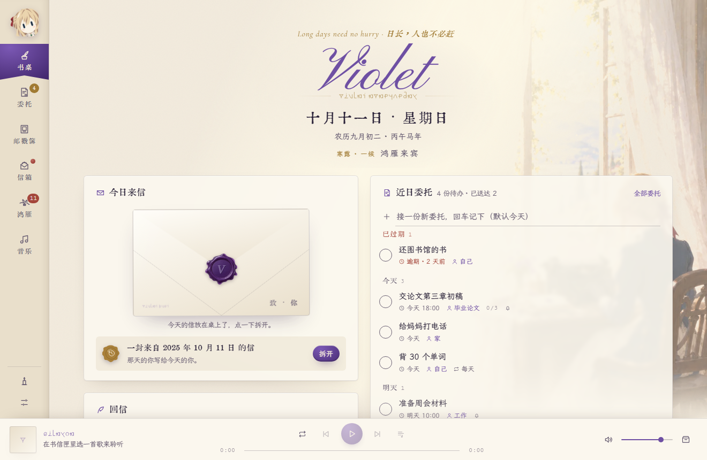

# Violet · 私人书桌

以《紫罗兰永恒花园》为灵感，将每日来信、个人日记、待办委托、日历与音乐融入一张温暖的私人书桌。在信笺与旋律之间，记录生活，珍藏日常。

Violet is a desktop app inspired by *Violet Evergarden*, bringing daily letters, journaling, tasks, a calendar, and music together on a cozy personal desk—a quiet place to reflect, stay organized, and treasure everyday moments.



## 功能 / Features

- **书信与日记 / Letters & journaling** — 每日来信、个人回信、寄往未来的信与每周封存袋。
- **委托与日历 / Tasks & calendar** — 待办委托、约定、纪念日，以及农历与节气。
- **音乐 / Music** — 三平台搜索下载、歌单、本地曲库、滚动歌词与随信夹歌。
- **鸿雁 / Campus notices** — 按配置的学校驿路收集通知，并根据收件人名片筛选。
- **桌面陪伴 / Desktop experience** — 昼夜主题、信纸与邮票、托盘提醒、本地备份和同步文件夹备份。

完整操作说明见 [使用说明](使用说明.md)。界面目前以中文为主。

See the [Chinese user guide](使用说明.md) for the full feature guide. The application interface is primarily in Chinese.

## 从源码运行 / Run from source

主要面向 64 位 Windows 10 / 11。需要 Python 3.10+、Node.js 20.19+（20.x）或 22.12+，以及 npm。桌面窗口使用 Microsoft Edge WebView2。

Primarily designed for 64-bit Windows 10 / 11. Install Python 3.10+, a Vite-compatible Node.js version (20.19+ on the 20.x line, or 22.12+), npm, and Microsoft Edge WebView2 for the desktop window.

```powershell
git clone https://github.com/violet202541/violet-desk.git
cd violet-desk

python -m venv .venv
.\.venv\Scripts\python.exe -m pip install -r requirements.txt

cd web
npm ci
npm run build
cd ..

.\.venv\Scripts\python.exe violet_app.py
```

改用浏览器打开 / Open in your browser:

```powershell
.\.venv\Scripts\python.exe violet_app.py --browser
```

前端构建完成、Python 依赖安装在当前环境后，也可以使用 `启动下载工具.bat`。首次克隆必须先构建前端；仓库不包含 `web/dist`。

The batch launcher can also be used once the frontend is built and Python dependencies are installed in the active environment. Build the frontend after cloning; `web/dist` is not tracked.

## 开发与检查 / Development & checks

后端与前端开发服务分别在两个终端运行 / Run the backend and frontend in separate terminals:

```powershell
# Terminal 1, repository root
.\.venv\Scripts\python.exe violet_app.py --serve --port 8765 --token devtoken

# Terminal 2, repository root
cd web
npm run dev
```

打开 / Open `http://localhost:5173/?t=devtoken`。

```powershell
# Repository root
.\.venv\Scripts\python.exe -m unittest discover -s tests

cd web
npm run build
```

## 打包 / Packaging

```powershell
# Build the frontend first, then run from the repository root
.\.venv\Scripts\python.exe -m pip install -r requirements-build.txt
.\.venv\Scripts\python.exe tools/build_exe.py

# Requires Inno Setup 6.5+
.\.venv\Scripts\python.exe tools/build_setup.py
```

产物位于 `dist/`，不纳入 Git。发布安装包时可使用 GitHub Releases。

Build outputs are written to `dist/` and excluded from Git. Installers can be distributed through GitHub Releases.

## 项目结构 / Project structure

| 路径 / Path | 内容 / Contents |
| --- | --- |
| `violet_app.py` | 桌面入口 / Desktop entry point |
| `violet_*.py` | 本地服务、书桌、书信、音乐库等模块 / Application modules |
| `chksz_dl.py` | 音乐下载命令行与接口 / Music download CLI and API helpers |
| `web/` | Vue 3 + Vite 前端 / Frontend |
| `data/` | 内置日历、寄语和学校驿路 / Bundled calendars, quotes, and notice routes |
| `assets/` | 美术源素材 / Source artwork |
| `tools/` | 字体、素材处理与 Windows 打包脚本 / Asset and packaging tools |
| `tests/` | Python 自动化测试 / Automated tests |
| `docs/` | 界面截图与设计说明 / Screenshots and design notes |

本地介绍站点 `site/` 有独立 Git 仓库，本仓库不包含它的部署配置；参考项目 `Listenary/`、`qmdec/` 及本机播放器 `foobar/` 也不属于应用源码。

The local introduction website in `site/` has its own Git repository and deployment. Local reference projects (`Listenary/`, `qmdec/`) and the installed `foobar/` player are excluded from this repository.

## 数据与素材 / Data & assets

个人数据默认保存在 `%APPDATA%\Violet`，API Key 保存在用户目录的 `.chksz_key`。个人信件、日记、设置、下载音乐、密钥和本机缓存均不纳入版本控制。音乐下载所需的 Key 由使用者自行配置。

Personal data defaults to `%APPDATA%\Violet`; API keys are stored in `.chksz_key` in the user's home directory. Personal letters, journals, settings, downloaded music, credentials, and local caches are excluded from version control. Configure your own API key for features that require one.

已有素材来源见 [素材说明](tools/assets/CREDITS.md)，字体说明随对应资源保留。第三方素材的权利归各自权利人所有。

See [asset credits](tools/assets/CREDITS.md) and the notices bundled with font resources. Third-party assets remain subject to their respective rights and terms.
