# Violet · v5.8

以《紫罗兰永恒花园》为灵感的私人书桌。每天早上 Violet 寄来一封信，你可以回信（日记），把要办的事写成「委托」（待办），在「邮戳簿」（日历）里翻看每一天。音乐的部分也还在：三平台搜索下载、歌单、本地曲库与滚动歌词。


## 启动

双击 `启动下载工具.bat`。需要 Python 3.10 或更新版本，第一次会自动安装 `pywebview` 与 `mutagen`，随后打开 Violet 窗口（没有黑色命令行窗口）。

也可以在本目录运行：

```powershell
python -m pip install -r requirements.txt
python violet_app.py            # 桌面窗口
python violet_app.py --browser  # 改用默认浏览器打开
```

`dist/Violet/Violet.exe` 是打包好的独立版本，不需要安装 Python。改了代码后运行 `tools/build_exe.bat` 重新打包。

### 安装包（分发给别人）

发给别人时用 **`dist/Violet-Setup-<版本>.exe`**，一个文件即可：

- **安装**：中文安装向导，默认只为当前用户安装到 `%LOCALAPPDATA%\Programs\Violet`，不需要管理员权限（开头也可以选为所有用户安装）。会创建开始菜单快捷方式，桌面快捷方式可选。要求 64 位 Windows 10 / 11。
- **下载的歌**：安装版默认存到「音乐\Violet」（`%USERPROFILE%\Music\Violet`），不放在程序文件夹里，可以在设置里改。
- **WebView2**：Windows 11 自带。Windows 10 上如果缺少 Microsoft Edge WebView2 运行库，安装结束时会提示并打开微软的下载页。
- **升级**：直接运行新版安装包覆盖安装。Violet 开着（包括在托盘里）时，安装程序会请对方先关掉；个人数据原样保留。
- **卸载**：在「设置 → 应用」里卸载。卸载时会问一次要不要连同信件、日记、压花和设置一起清掉，默认保留。下载的歌无论如何都不会删。
- **API Key**：每个人要在 Violet 里填自己的 Key，安装包里不带任何 Key。
- **安全提示**：安装包没有数字签名，第一次运行时 Windows SmartScreen 可能提示「已保护你的电脑」，点「更多信息 → 仍要运行」即可。

重新生成安装包：运行 `tools/build_setup.bat`（先打包 exe，再生成安装包）。需要 [Inno Setup 6.5+](https://jrsoftware.org/isinfo.php)（`winget install JRSoftware.InnoSetup`）。安装向导的中文文案在 `tools/installer/ChineseSimplified.isl`，配置在 `tools/installer/violet.iss`，向导里的插图由 `tools/installer/make_wizard_art.py` 画出。

已经开着的 Violet（包括退在托盘里的）再启动一次，只会把原来的窗口叫到前面，不会开第二个。

## 个人数据放在哪里

委托、回信、来信、照片、设置和寄信记录都放在 **`%APPDATA%\Violet`**。bat 和 exe 共用这一份，重新打包也不会动到它。设置页「备份」里可以一键打开这个文件夹。

第一次启动 v5 时，会把旧版放在程序旁边的 `.violet_*.json` **复制**过去，原文件保留不删。旧设置里的相对下载目录（`./music`）会换成绝对路径，下载位置不变。想放到别处，可以设置环境变量 `VIOLET_DATA_DIR`。

API Key 仍然只存在 `~/.chksz_key`，不会进入数据文件夹，也就不会进入备份。

## 备份到百度网盘

- **本机快照**：每天第一次打开和退出时自动备份到 `%APPDATA%\Violet\backups`，保留最近 7 份。
- **同步到网盘**：在「设置 → 备份」里选一个同步文件夹，例如百度网盘客户端「同步空间」里的一个目录。之后每份备份会再复制一份过去，保留最近 30 份，由网盘客户端负责上传；Violet 不需要登录网盘。
- **恢复**：在「从备份恢复」里点一份即可。恢复前会先把当前数据另存一份「恢复前」快照。

## 窗口与托盘

- **标题栏**：Violet 使用自绘标题栏。拖动顶部空白处移动窗口，双击最大化，拖边缘缩放，拖到屏幕边缘可以贴靠分屏。显示异常时设置 `VIOLET_SYSTEM_FRAME=1`，可以改回系统标题栏。
- **关闭与托盘**：点关闭会退到右下角托盘，提醒照常送达。左键点托盘图标打开窗口；右键菜单可以打开书桌、写回信，或者彻底退出。不想要托盘，可以在「设置 → 开场与托盘」里关掉，关掉后点关闭就是退出。
- **开场动画**：每天第一次打开时播放：水彩晕开，钢笔写下 Violet。当天再打开就直接进书桌。开场也可以在设置里关掉。

## 侧栏

| 书签 | 白话 | 用途 |
| --- | --- | --- |
| 书桌 | 今日 | 今天的来信、你的回信、今日委托、约定与纪念日、快速寻歌。周日会多一个「封存袋」 |
| 委托 | 待办 | 所有要办的事，按今日案头（今天）/ 来日（接下来）/ 闲笺（无期限）/ 已送达和委托人分拣 |
| 邮戳簿 | 日历 | 月历和每一天的详情，包括农历、节气、节日 |
| 信箱 | 来信与日记 | Violet 的来信、你的回信、寄往未来的信、每周封存袋、收藏 |
| 鸿雁 | 学校通知 | 沿驿路去学校各处取通知，按你的收件人名片拣出和你有关的，见「鸿雁」一节 |
| 音乐 | 寻歌 · 歌单 · 书信匣 · 信札 · 寄信室 | 页面顶部的索引签切换五页 |
| 设置（底部） | — | Key、下载目录、音质、灯光、开场与托盘、背景画、备份 |

鼠标停在书签上会显示白话说明。Alt+1 到 Alt+7 依次切换以上七项。

## 光阴与联动

- **窗光**：书桌、寻歌页和写信页的背景上有一道斜光，颜色随时辰变：清晨偏冷白，正午暖白，下午金黄，傍晚带一点玫瑰色，光里浮着细尘。烛光主题下换成桌上油灯的微光和几点萤火。
- **天气**：回信贴了天气邮票，窗外就跟着变：雨、雪、风里飘的紫色花瓣、雾，打雷时屋里偶尔一亮。写信时换一枚天气邮票，背景马上跟着变。
- **七十二候**：书桌日期下面写着现在是哪个节气的第几候，例如「寒露 · 一候 鸿雁来宾」，鼠标停上去有白话解释。新的一候开始那天，Violet 会在信末的附言里提一句。
- **寄送的动画**：
  - 办完的委托化成一枚邮戳，飞进侧栏的「邮戳簿」。
  - 封好的回信和封存袋飞进「信箱」。
  - 夹进回信的歌飞向「书桌」。
  - 接住东西的书签会轻轻一跳。
  - 侧栏的紫色丝带会滑到新的书签上，切换页面时纸页翻过去，音乐四页之间左右滑动。
- **今日事毕**：今天最后一份委托送达时，书桌上会压下一枚金色的「毕」字火漆。
- **随手夹歌**：播放条上的信封按钮，或书桌日期下的「正在听」，都能把正在放的歌夹进今天的回信，不用先打开信纸。
- **问候**：书桌最上面那一行中英对照的问候，随时辰、节气和回信的天气邮票变，混着三种口吻：短短的一句景（「日影正短，喝杯茶吧」）、半句古诗（「云中谁寄锦书来」）、Violet 的书信口吻（「今天也为你代笔」）。节气当天的白天先说节气。同一天、同一个时辰里不变。

这些动效都可以在「设置 → 灯光与声音 → 光影与动效」里关掉，关掉后只留静态的光。系统开启「减少动态效果」时也会自动收起。

## 每日来信

Violet 的信每天放在书桌上，信封带一点飘落的动画。点一下，火漆碎开，信纸抽出。信里有这几部分：

- **寄语**：内置约 180 条，都注明出处；每三天会尝试从「一言」诗词分类取一句。
- **新歌**：挑书信匣里还没有的歌。从哪儿挑在「设置 → 每日来信的新歌」里定：
  - 网易云和 QQ 音乐的公开榜单（飙升、新歌、热歌、原创、欧美、日语、说唱、古典……），勾哪几个都行。
  - 「按我的口味」：从书信匣里常听的歌手出发，找他们你还没有的歌。
  - 自己留的歌单：粘贴网易云或 QQ 音乐的公开歌单链接。
  - 每天挑一到五首。一天最多用其中两处，信里会写明这几首是从哪儿来的。都走公开接口，不登录、不需要 Key、不耗额度。
- **旧信**：书信匣里一首很久没听的歌。
- **鸿雁**：如果写了收件人名片，信里会有一段按当天真实收到的学校通知写成的话：送来几封、来自哪里、为什么和你有关、哪天截止。没有相关通知的日子，这一段就不出现。
- **附言（P.S.）**：节气和节日、新的一候、昨天没办完的委托、今天的约定、快到的纪念日、从过去寄来的信、周日的封存提醒。

信的抬头怎么称呼你，可以在「设置 → 称呼与落款」里改，例如填「小满」，抬头就写成「亲爱的小满：」「小满，见字如面：」，旧信也跟着改口。

信末有「回信」按钮。

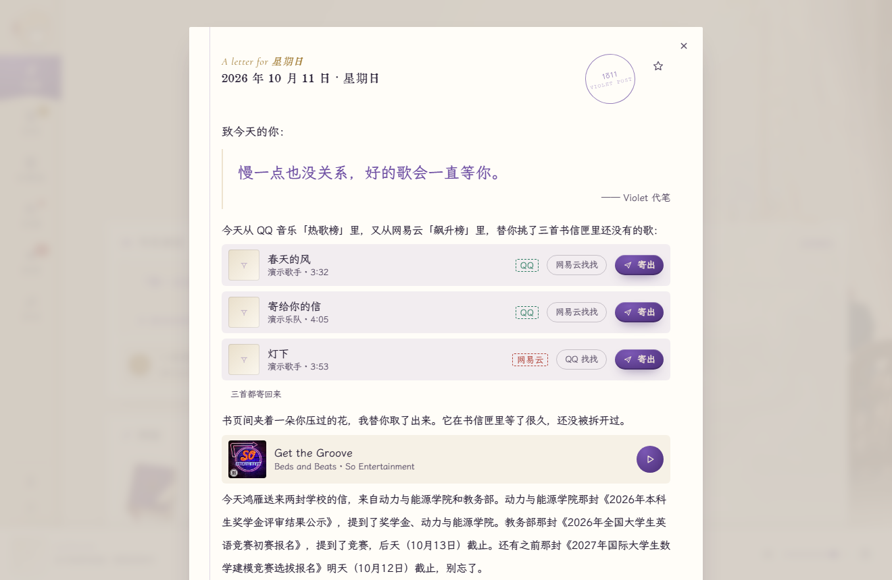

## 回信（日记）

在书桌或信末点「动笔」，会铺开一张信纸，默认写给 Violet。

- **自动保存**：停笔约一秒就自动收好，顶部写着「已收好 · 时间」。用中文输入法拼字时不会打断；切页、关窗口前也会先存。保存失败时会明确提示，不会假装存好了。
- **邮票夹**（右侧）：
  - 心情邮票 8 种、天气邮票 8 种，贴在信纸右上角。
  - 一日一曲：把正在听的歌或今天听过的歌夹进信里，重读时可以直接播放。
  - 照片：点按钮或直接拖进信纸，自动缩到合适大小，以拍立得的样子夹在信里。
  - 拾句：从这一天里拾来的几句话：节气与候、天气、办完的委托、约定、听得最多的歌、代笔时长。点一下，打字机会把这句打在光标处。
  - 附上今日委托：封缄时把今天送达的委托列在信末，可以关掉。
- **遮信**：点「遮信」，信纸上的字会像被水洇开一样逐行化掉，再一笔一笔写成泰尔西斯文字，旁人看不懂。字迹照着动画里信件的样子：细钢笔单线、小而圆的字母、词与词之间空得开、每行右边参差、行稍稍起伏。再点「掀开」变回中文。
  - 每两个汉字写成一个泰尔西斯「词」，同一个字永远写成同样的字母。这只是遮给旁人看的，不是加密。
  - 遮着也能接着写，新打的字会直接以密文写出来。密文按行和原文对应，但不和每个字对齐，所以遮着时光标只对得上在哪一行。
  - 信箱里的回信卡片、重读旧回信的信纸上也有「遮信」，三处各管各的，也不会记住。
- **提笔话题**：信纸空着时，顶上淡淡给一句引子，例如「今天让你笑出来的一件事是？」。可以「换一句」，也可以「用这句开头」。贴了心情邮票，就挑合心情的话题。
- **文具匣**（右侧最上面）：这封信用的信纸、字与墨、火漆、邮票和信封，见下一节。
- **落款**：在「设置 → 称呼与落款」里写好，每封回信右下角就署上它。
- **封缄寄出**：选「Violet」，或者选「未来的我」并挑一个日子（一个月后、半年后、一年后、三年后或自选）。旁边会摆出这封信的信封正面：邮票、收信人、启封日。点「盖上火漆」，信纸折起来装进信封，背面压下你选的火漆。寄往未来的信那天会作为来信回到书桌上，在那之前拆不开；信箱「寄往未来」里能看到它在路上走了多远。已封缄的信可以「拆开重写」。
- **存成图片**：重读一封回信时，点「存成图片」，会用这封信自己的信纸、抬头、格线、字和墨重新画成一张 PNG：右上角贴着邮票、盖着封缄那天的邮戳，信尾压着火漆。桌面窗口里会弹出「另存为」，浏览器里直接下载。

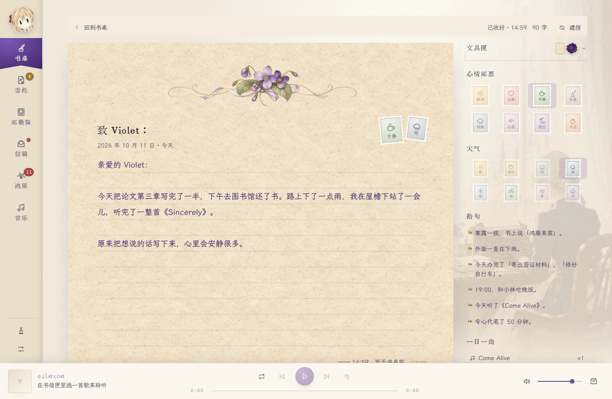

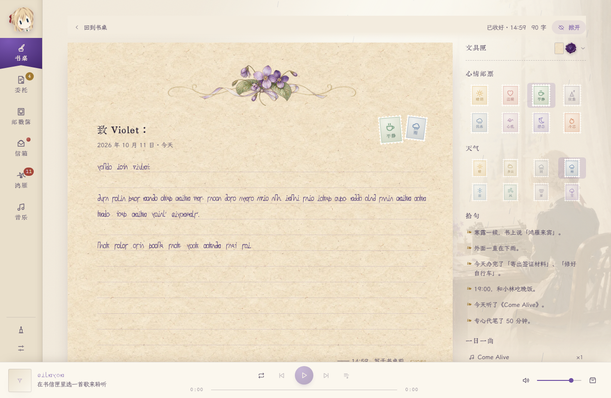

## 文具匣

写信时右侧最上面的「文具匣」，和「设置 → 文具匣」里是同一套东西：设置里挑的是新信纸默认用的那一套，写信时可以临时换。每封信封缄时会记住自己用的那套（连同落款），以后在信箱里、重读时、存成图片时都还是那个样子。

- **信纸**：羊皮纸、淡紫条纹纸、压花手工纸、牛皮纸、素笺。
  - 格线：横线、方格、稿纸格（一格一个字）、空白。
  - 抬头与花边：紫罗兰、铃兰、金线花饰、邮政公司的打字抬头，或不要抬头。
- **字与墨**：七款字体：文楷、小赖、明朝、小薇、楷书、行书、手札。墨水有紫罗兰、蓝黑、深褐、墨绿、炭黑五色。
- **火漆**：八种蜡色：紫罗兰紫、酒红、祖母绿、古金、墨蓝、炭黑、珍珠白、樱粉。印面图案有：
  - 字母：V 字，或你自己的 1–3 个字母。
  - 花与植物：紫罗兰、铃兰、麦穗、橄榄枝。
  - 代笔的器物：羽毛笔、钥匙、铃铛、胸针、拆信刀。
  - 天空与飞鸟：鸿雁、月与星、太阳、云。
- **邮票**：八枚莱登风光：港口、钟楼广场、邮政公司、绿色电车、花田、灯塔、雪山、夕阳海。也可以「照片邮票」：选一张自己的照片，裁成带齿孔的邮票。三种色调：原色、旧照片、雕刻版。
- **信封**：西式三角封口、航空信封、中式竖封、驿站公文袋（牛皮纸、绕线扣）。

夜里（烛光主题）信纸不会变黑，只是暗一些，像灯下的纸，字照样是白天的墨色。

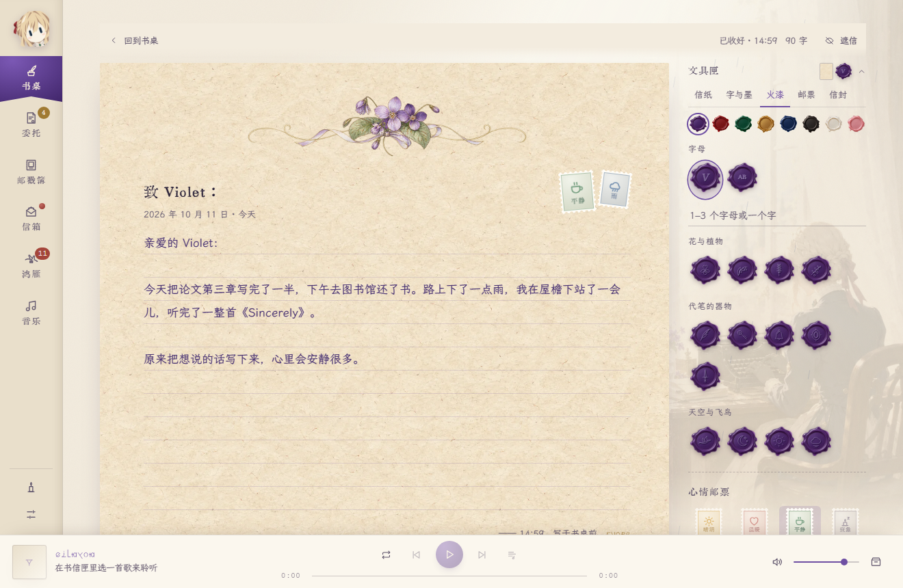

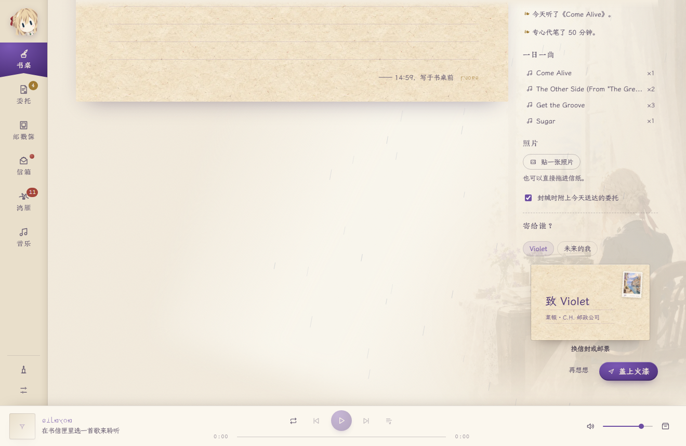

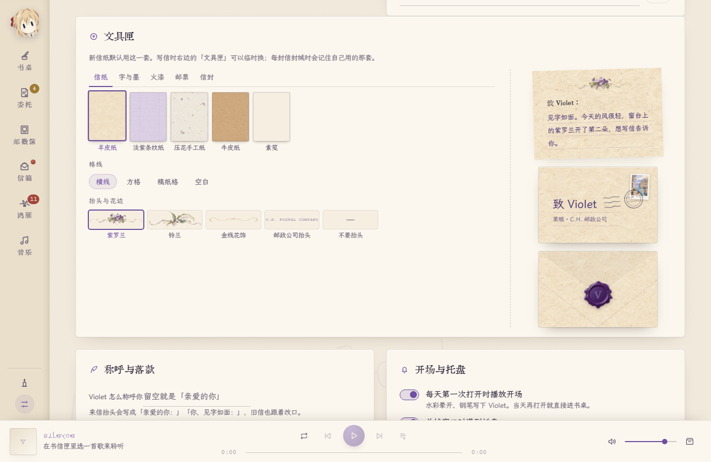

## 委托（待办）

- **快速新增**：在书桌或委托页的输入框写一句，回车就接下一份委托，默认期限今天。Ctrl+N 打开空白委托单。
- **委托单**（点委托打开，从右侧滑出）：
  - 委托人：为谁、为哪件事，可以用来分组。
  - 期限：今天、明天、这个周末、下周一、无期限，或者选具体日期和时间。
  - 提醒：准时、提前 10 分钟、提前半小时、提前 1 小时、提前 1 天。
  - 重复：每天、每周（可以选星期几）、每月、每年。办完一份，下一份自动排好；撤回「已送达」时，会收回还没动过的下一份。
  - 分步骤、附注。
- **误了邮期**：逾期的委托单会镶上红蓝相间的航空信封边。
- **完成**：点左边的圆圈，盖上「已送达」邮戳。完成和撕掉都可以在提示条里撤销；撕掉的委托 30 天后才会真正清除。
- **书桌上的「近日委托」**：分成「已过期 / 今天 / 明天 / 这周内」几组，更远的折成一行「之后还有 N 份委托 →」。鼠标停在一份上，可以推到明天或下周一（提示条里能撤销），也可以直接开始代笔时间。
- **代笔时间**：在委托上点沙漏，进入专注计时，可选 25、45、60 分钟或不计时。打字机的纸卷会随时间写满。「伴奏」从书信匣随机放歌。结束后用时记在委托单上。


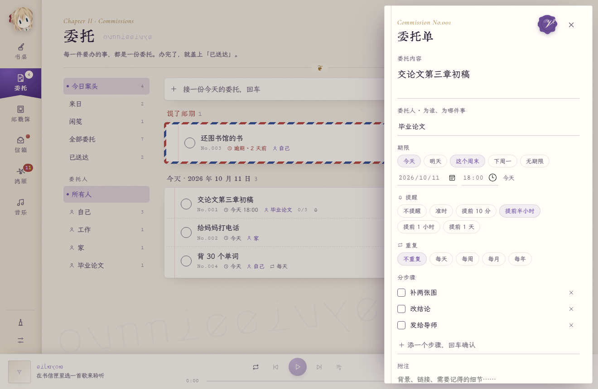

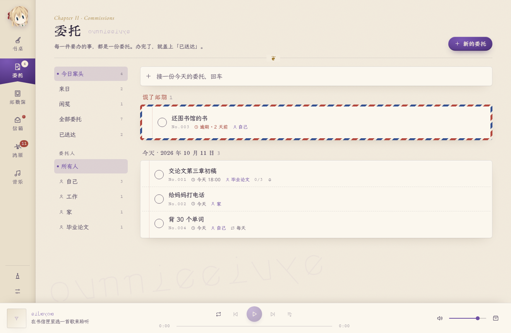

## 约定与纪念日

- **约定**：某天某时要去的事，比如吃饭、看牙。不用打勾，可以写地点，可以提醒。
- **纪念日**：每年都会回来的日子，比如生日、相识纪念日。可以勾选「按农历过」，邮戳簿和书桌会显示「第 N 年」。

提醒以 Windows 系统通知送达，同时在窗口里弹出提示条，并作为附言写进当天的来信。Violet 关着时错过的提醒，12 小时内再打开会补发一次；提醒只在 Violet 运行（包括在托盘里）时有效。

## 邮戳簿（日历）

每一天是一枚邮票：

- **日期标注**：农历日期、节气（绿色）、节日（红色）。
- **记录标记**：火漆表示那天写了回信（虚线圈是草稿），心情邮票表示当天的心情，圆形邮戳上的数字是那天送达的委托数，小唱片表示那天听过歌，金色数字是到期的委托数。

点一天，右侧会列出那天的来信、回信、委托、约定、听过的歌和代笔时间，以及那天属于哪一候。今天和以后的日子可以直接「＋ 这天的委托」。方向键可以在格子之间移动；翻月时邮票会一枚枚贴上去。

农历按天文算法推算（覆盖 1900–2100），与紫金山天文台历表一致。节气覆盖二十四节气，节日包括春节、元宵、端午、七夕、中秋、重阳、腊八、除夕等传统节日和常见公历节日。

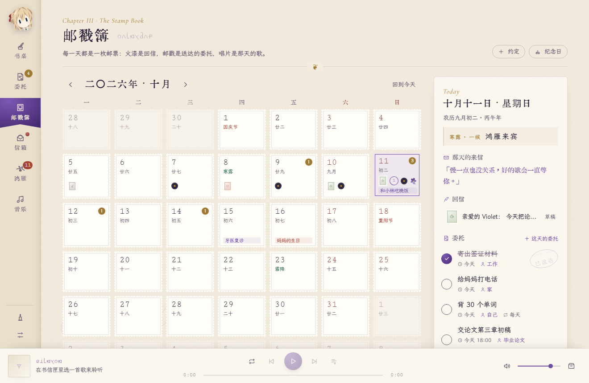

## 每周封存

每个周日（以及之后的周一、周二，如果上周还没封存），书桌上会出现「本周封存袋」。里面有：

- 这一周送达的委托
- 写了几封回信
- 每天的心情邮票
- 听得最多的歌
- 代笔时长

写下一句想留下的话，系绳封存后放进信箱的「封存袋」。

## 鸿雁（学校通知）

鸿雁传书：Violet 替你去学校各处的通知栏取信，只把和你有关的拣出来，不用再上官网在一堆采购公告里翻。

- **收件人名片**：第一次打开「鸿雁」，先写一张名片——
  - 学校和学院：学院的通知会多看一眼，别的学院的会略过。
  - 本科还是研究生、哪一年入学：提到「2024级」「大三」的通知会被拣出来，研究生的通知会往后放（反之亦然）。
  - 关心的事：竞赛、考试、奖助、选课、讲座、实习就业、出国交流、推免考研、活动，也可以自己写一项。每项是一组关键词，可以增删。
  - 不想看的事：标题里出现这些词（默认有采购、竞选结果、招标……）就直接放进「未拆的信」。
  - 送信方式：「随到随取」（每条驿路按自己的节奏，默认两小时一次）或「晨间一批」（每天早上一次）。
  - 写完会**当场试拣**最近一个月的通知：告诉你按这张名片会收到几封、几封会被放进未拆的信，不满意可以回去改。
- **邮局分拣室**：鸿雁这一页的背景是一间邮局分拣室，白天是窗外的晨光，烛光主题下换成台灯和月光。右上角可以在「信绳」和「清单」两种看法之间切换，会记住你上次用的。
- **信绳**：窗前拉着几根细麻绳，名片上每项「关心的事」是一根，绳头钉着一张纸签；另有一根「杂信」；别着翡翠胸针的信挂在最上面一根。
  - 信用木夹子夹在绳上，随风轻轻晃：没拆的露正面（驿路邮戳和短标题），拆过的翻成背面；急件用红夹子、盖「速达」戳；截止日写在信下面垂着的小纸签上，三天内截止的是红字。
  - 鼠标在一封信上停一会儿（或点一下），窗边会吹来一阵风：这一根绳上的信依次晃一下，这一封先被揭起一角，再脱开夹子，翻飞着转到你眼前，变成一张明信片：完整标题、为什么拣给你、截止日，以及「记成委托」「别上胸针」「拆开」。风里会带过几片紫罗兰花瓣。鼠标移开，风又把它卷回夹子上。信飞到眼前后再点一下就拆开。
  - 一根绳上挂不下时，接着挂到下面一根续绳上，和上面的信对齐。还没有信的绳先不拉出来，把地方留给有信的。
  - 绳下是一只藤编信篮（未拆的信）和一只铁皮信盒（旧信），点开后信摊在下面。
- **清单**：一张薄信笺，像打字机打的收信清单。顶上一行分类小字：全部、每一项关心的事、未拆的信、旧信。每封信一行，编号、日期、驿路、标题，标题和截止日之间用点线连着；急件在右边页缘盖「速达」，别着翡翠胸针的在左边页缘别着一枚胸针。
- **取信时**：邮差骑着车从页面上骑过，下面写着正在走哪条驿路；新信到时，一只雁从窗前飞过。
- **拆开一封**：正文铺在信纸上，标题和正文都可以选中复制。截止日期用红笔圈出来，你关心的词用荧光笔划出来，附件列在信尾，排版乱了可以点「去原网页」。每封信都写明「为什么拣给你」。
  - **记成委托**：带着截止日（和时间，例如「晚 20:00」）开一张委托单，确认后才建，邮戳簿那天会标出来。也可以「写进约定」。
  - **别上翡翠胸针**：重要的信别一枚翡翠胸针，挂在最上面一根绳上，永远不会被收进旧信。
- **纠错**：
  - 没拣出来的信放在绳下的「未拆的信」信篮里，留 30 天。拆开一封，点「这封对我有用」。
  - 拣错了，点「以后别送这类」。
  - 两种情况，Violet 都会从标题里挑几个候选词给你勾选，选好插进哪一格。勾了才写进名片，一个也不勾就只处理这一封。它不会偷偷自己学。
- **旧信**：截止日期过了、或者送来满两周的信会收进「旧信」信盒，留一年，可以搜索。
- **急件**：很相关、或者相关且三天内截止的信，会弹一条系统通知；同时到的几封合成一条，夜里 23 点到早上 7 点不打扰。名片里可以关掉。第一次取回的那一批不会弹通知。
- **书桌上的信插**：书桌左边会插着最相关、还没拆的一两封学校的信；没有新信时信插不出现。
- **驿路**：页面右上角「驿路」里能看到每条路通往哪个通知栏、上次什么时候取过信、有没有出错，也能单独关掉。同一个网站的路一次只走一条，中间歇一歇；没变化的页面不会重新下载。
  - 内置「西北工业大学」驿路包：教务部、学校公告、学生工作部、校团委，以及动力与能源学院（学院通知、本科生教学）。学院的驿路只在名片选了对应学院时才启用；别的学院以后会陆续补上。
  - **导入驿路包**：别人写好的 `.json` 驿路包可以直接导入。装之前会先试取一次，让你看看取回来的是什么。
  - **含脚本的驿路**：有的驿路附带一小段脚本，用来处理特别的网站。脚本只在沙盒里运行：不能联网、不能读写文件，也碰不到你的数据，限时两秒，只能把网页文字变成通知列表。导入时这类驿路盖着「含脚本」的封缄，点开能看到脚本全文，你点「我信任它」之后才会启用。
- **要登录的门户**：需要登录的门户（例如翱翔门户）在 Violet 自己的小窗口里打开学校的官方登录页，你在那里输入账号密码。Violet 只保存登录后的会话，并用 Windows 的加密存在本机，不保存密码，也不会进入备份；会话过期时会提醒你重新登录。
- **数据**：通知、名片、驿路和你的纠错都存在 desk.db 里，每天的备份会一起带上。

驿路规则怎么写的说明文档，会在正式发布做介绍页时一起整理。

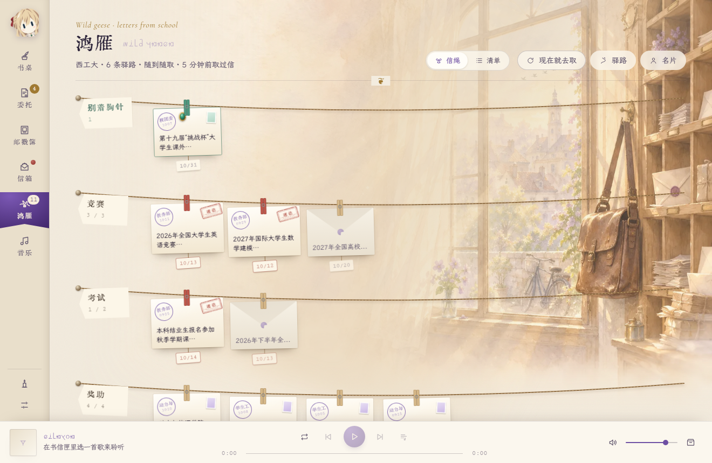

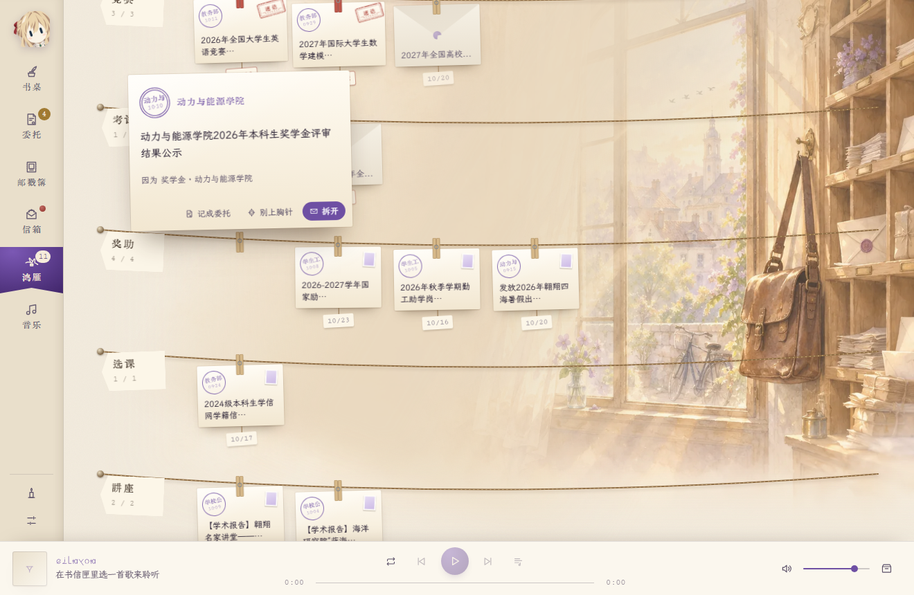

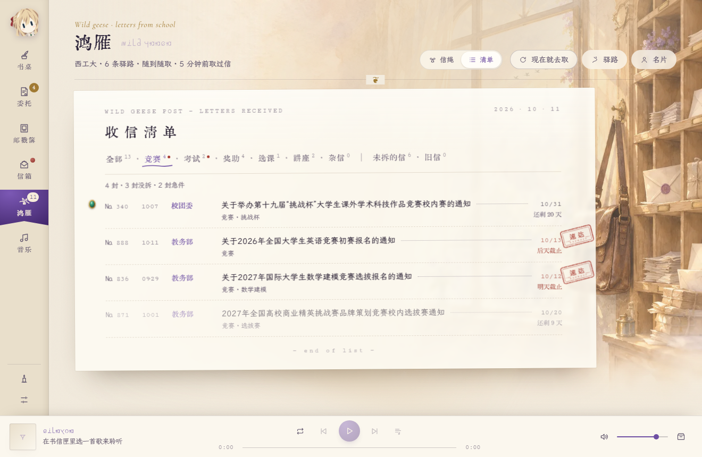

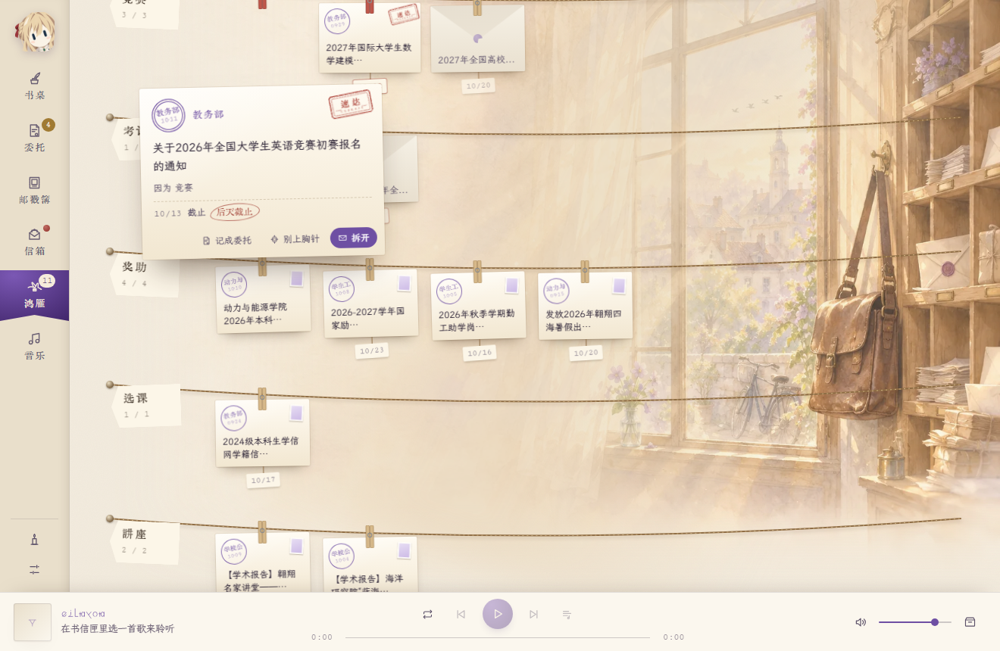

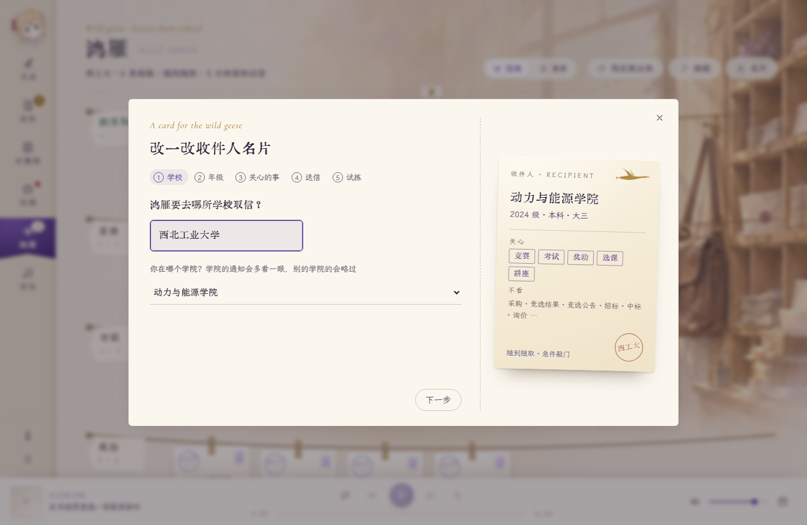

## 音乐

| 分页 | 用途 |
| --- | --- |
| 寻歌 | 写下歌名、歌手或一句歌词，选平台邮票后回车。点行勾选，Shift 选连续范围；「再找一些」继续翻页（网易云分页，QQ 扩到 50 首，酷狗只有一页） |
| 歌单 | 粘贴 QQ 音乐或网易云的公开歌单链接或 ID |
| 书信匣 | 本地曲库，卡片 / 列表视图，点击播放，读取内嵌或同名 `.lrc` 歌词；可以退回下错的歌、整理重复的歌 |
| 信札 | 收藏（压花集）与自己的歌单（信札），见下一节 |
| 寄信室 | 下载队列与往来记录，可撤回、重试、在文件夹中显示 |

搜索与下载需要 [ChKSz API](https://api.chksz.com/#apis) 的 Key（`chksz_` 开头），第一次需要时会弹窗询问；勾选「记住它」会写入 `~/.chksz_key`，与命令行工具共用。环境变量 `CHKSZ_API_KEY` 优先。


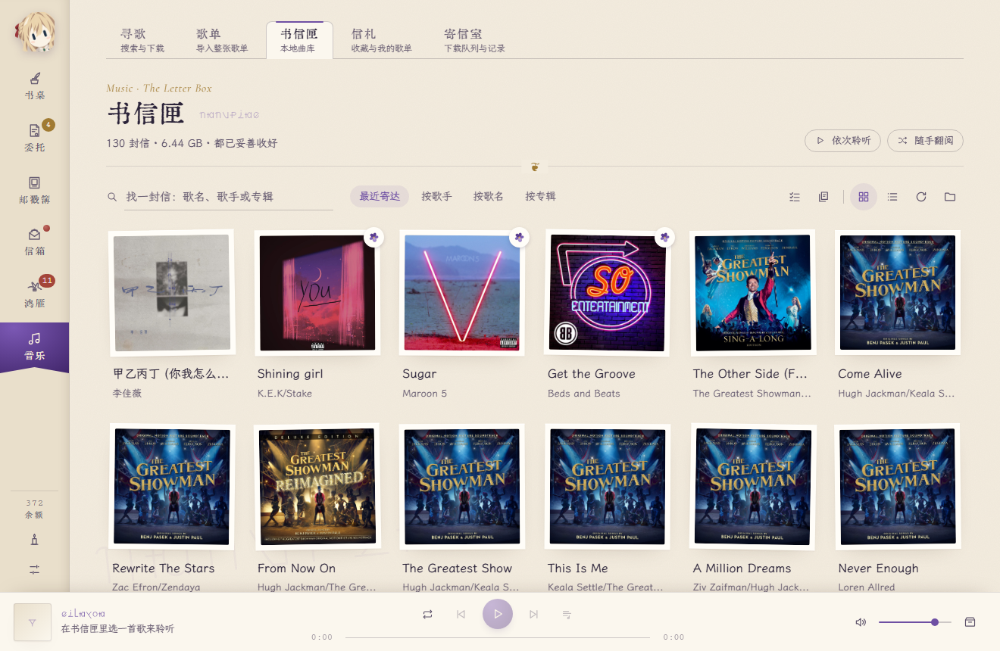

**退回下错的歌**：

- 鼠标停在一首歌上，收藏、加入信札旁边有一个红色的「退回」。
- 工具栏的「整理」可以勾选好几首，一起夹进信札或一起退回。
- 退回前会弹出一张退信单，写明这首歌夹在哪几本信札里、是不是干花、进过几封回信。
- 确认后，音频连同同名歌词移进 Windows 回收站，想找回可以去回收站还原。
- 它会从信札和压花里取下；旧回信里还留着歌名，只是不能再放。如果书信匣里还有同一首歌的另一份，干花和信札会改夹那一份。
- 正在放的那首会先停下，接着放下一首。
- 寄信室里对应的记录也会清掉，方便重新下载对的版本。

**找出重复的歌**：工具栏里的这个按钮会把同名同歌手的几份并排列出来，比一比格式、码率、长短和所在文件夹。默认留无损、码率高、更完整的那份；长短差得多的可能是现场版或别的版本，先都留着。确认后，多余的那几份一起退回。

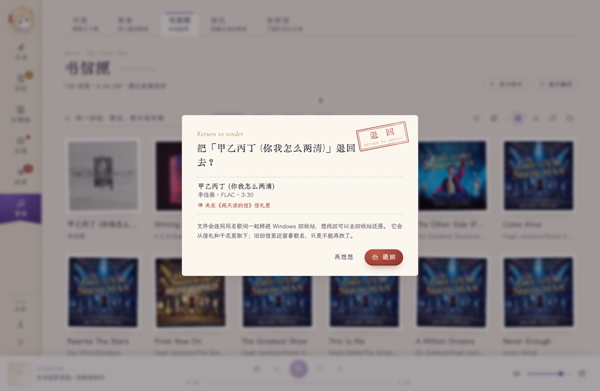

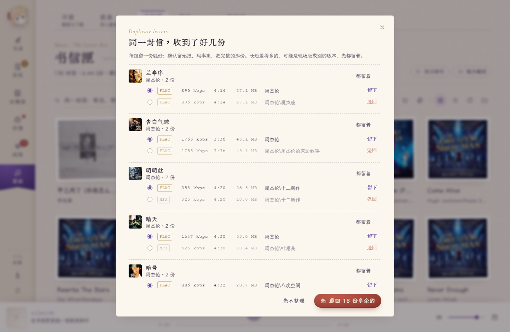

**桌面歌词**（只在桌面窗口里有）：播放栏右边的「词」字打开。

- 歌词浮在所有窗口最上面：当前这句大、下一句淡，用文具匣里选的字体和墨色。
- 没锁时是一张能拖动的纸笺，鼠标停上去可以调大小、锁住或收起。
- 锁住后纸笺隐去，只剩描了边的字，鼠标可以从它身上穿过去；要再拖动，就在播放栏里点小锁解开。
- 它会记住位置；下次打开 Violet 时，如果上次开着，它也跟着出来。

下载规则不变：

- 同时最多 4 首，同一首不会重复入队。
- 每首按入队时的设置下载。
- 首选音质没有时逐档降级；鉴权、额度、限流类错误会暂缓排队中的任务。
- 先写 `.part` 临时文件，完整后才生成正式文件。
- 本地已有同名文件就跳过，从不覆盖。

## 信札与压花（收藏与歌单）

- **压花（收藏）**：
  - 书信匣里每首歌的封面角上、播放条歌名旁边，都有一朵小小的堇菜花。点一下，花瓣一片片摊开、染上颜色，这首歌就压进了「压花集」。压过的歌，封面角上会一直留着这朵花。
  - 每朵花可以写一句**压花笺**，写下为什么喜欢它。
  - 压花会出现在别处：
    - 邮戳簿：那一天的格子里有一朵小花，右侧列出「那天压的花」。
    - 回信：「拾句」里有一句「把《……》压进了书里」。
    - 每周封存袋：写着这周压下的花。
    - Violet 的来信：「旧信」常常挑一朵你压过、又好久没听的花。
    - 一年后的同一天：来信附言里会说「一年前的今天，你把《……》压进了书里」。
- **信札（歌单）**：一束用缎带扎起来的信。
  - 扎一束：在「信札」页点「扎一束新信札」，起名字、写一句题记（可以不写），挑一条缎带（紫罗兰、酒红、普鲁士蓝、苔绿、旧金、灰玫瑰）。
  - 夹进去：在书信匣的歌上、或播放条上点缎带图标，选一束信札；也可以在打开的信札里直接搜书信匣，点「夹进来」。同一首歌不会夹两次。
  - 打开一束：缎带解开，信一封封摊开。可以「从头读起」「随手抽一封」，拖动调整顺序，把某封「抽出来」（提示条里能放回去），也可以「重新扎」或「拆散」。拆散的信札 30 天内可以在提示条里重新扎起，歌本身一直在书信匣里。
  - **抄成信札**：在「歌单」页展开一张在线歌单后，点「整张抄成一束信札」，或者先勾选几首再抄。书信匣里已有的歌马上收进来；还没有的会顺便寄回来（下载），在那之前标着「在路上」，寄到书信匣后自动认领。
- **文件挪动了也不丢**：信札和压花记着每首歌的歌名、歌手和专辑。音乐文件被挪走或改名后，Violet 会按歌名和歌手重新认回来；实在找不到的标成「遗失」，不会悄悄消失。
- **存放与备份**：信札和压花与委托、回信存在同一个数据库里，每天的备份自然包含它们。

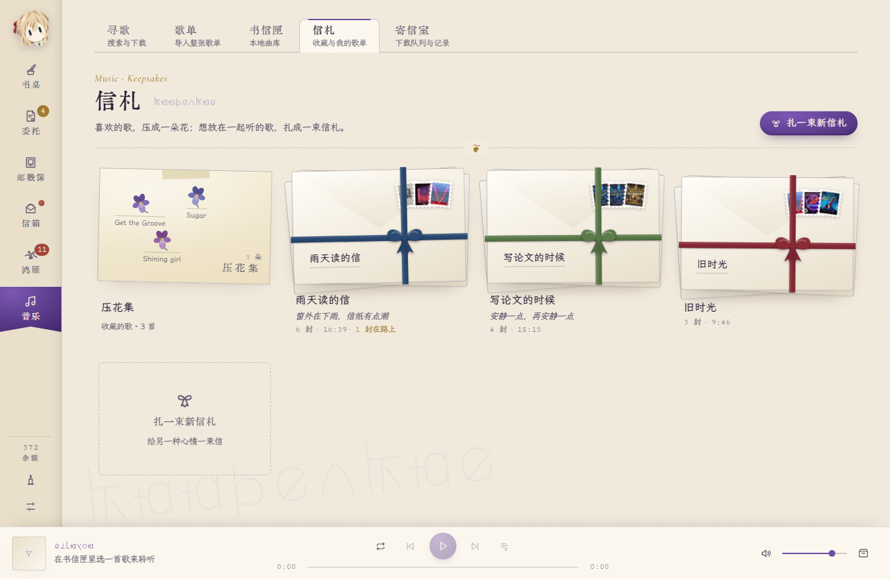

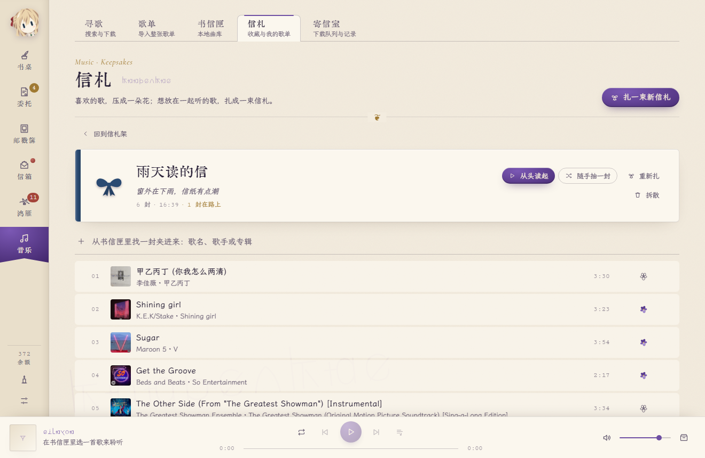

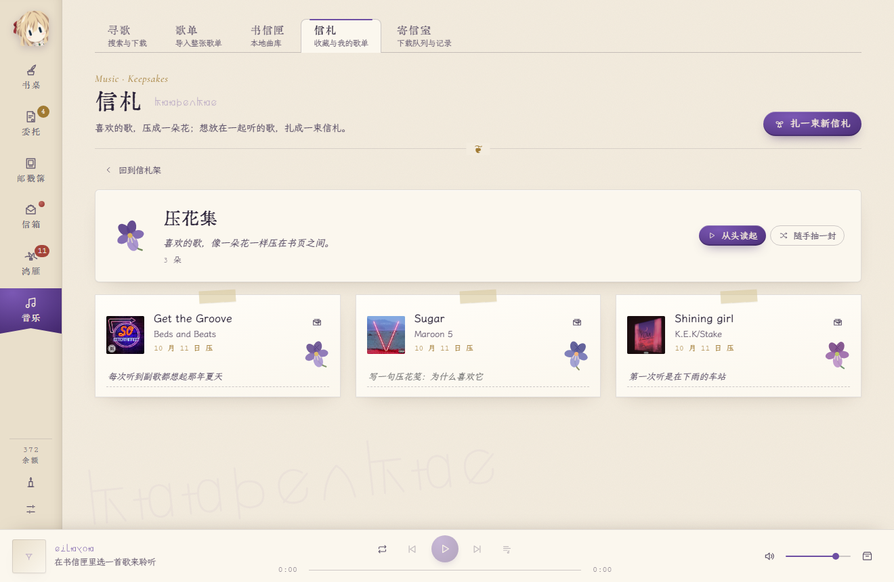

## 背景画

书桌和寻歌页铺着一幅淡水彩：她在窗边打字写信。烛光主题下换成同一场景的夜景，窗外是星空和小城灯火，桌上点着一盏油灯。鸿雁那一页另有一幅邮局分拣室（白天晨光、夜里台灯与月光），不跟随自选图片。

- **换成自己的图**：在「设置 → 背景画」选一张。图片只在本机读取，左侧会自动淡出给文字留位置。
- **接入生成的新图**：logo、白天 / 夜间背景画的生成提示词在 [docs/生图提示词.md](docs/生图提示词.md)。生成好后放进 `docs/art-inbox/`，运行：

```powershell
python tools/import_art.py
cd web; npm run build
```

它会生成窗口 / 任务栏 / exe 图标、侧栏 logo，以及白天 / 夜间背景画，背景画的纸色底会自动去掉。要让 exe 也换上新图标，再运行一次 `tools/build_exe.bat`。

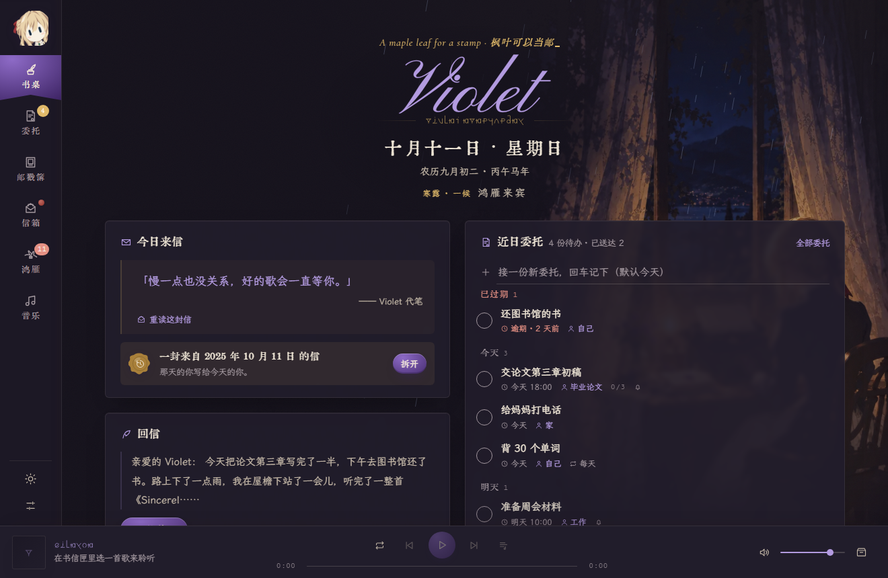

## 快捷键

| 按键 | 操作 |
| --- | --- |
| Alt+1 … Alt+7 | 书桌 / 委托 / 邮戳簿 / 信箱 / 鸿雁 / 音乐 / 设置 |
| Ctrl+N | 新的委托 |
| `/`、Ctrl+K、Ctrl+F | 去寻歌并聚焦搜索框 |
| Enter | 寻找 / 展开歌单 / 记下快速委托 |
| Ctrl+D | 寄出所选（音乐页） |
| Ctrl+A（不在输入框时） | 全选当前可见曲目 |
| 空格（不在输入框时） | 播放 / 暂停 |
| Ctrl+← / Ctrl+→ | 上一首 / 下一首 |
| Shift+← / Shift+→ | 后退 / 前进 10 秒 |
| ← → ↑ ↓ | 邮戳簿里换日子；播放进度条聚焦时调整进度 |
| Esc | 关上弹窗、委托单、信纸或歌词页 |

所有弹窗都可以只用键盘操作：打开时焦点自动进入，Tab 在弹窗内循环，Esc 关闭，关上后焦点回到原处。

## 命令行

原有命令行工具保留不变：

```powershell
python chksz_dl.py check
python chksz_dl.py search-all 晴天
python chksz_dl.py download netease 186016 -q lossless -o ./music --lyric --cover
python chksz_dl.py qqplaylist 9080103532 -o ./music --all --lyric --cover
python export_lrc.py ./music
```

## 开发

```powershell
python violet_app.py --serve --port 8765 --token devtoken   # 后端（固定令牌）
cd web; npm install; npm run dev                            # 前端热更新：http://localhost:5173/?t=devtoken
npm run build                                               # 构建前端（web/dist 已随项目提交）
python -m unittest discover -s tests -v                     # 测试（不调用真实接口，不碰真实数据）
python audit/demo_server.py                                 # 离线演示服务，数据全在临时目录
node audit/screenshots.mjs; node audit/screenshots.mjs --dark
python tools/build_almanac.py                               # 重新推算农历与节气表
python tools/trim_fonts.py                                  # 改了界面文字后，补齐需要的标题字体分块
```

| 文件 | 内容 |
| --- | --- |
| `violet_core.py` | 数据目录与旧数据搬迁、偏好、Key、下载队列、寄信记录 |
| `violet_desk.py` | 书桌（SQLite）：委托、约定与纪念日、回信、聆听记录、代笔时间、每周封存、提醒 |
| `violet_letters.py` | 每日来信与播放记录 |
| `violet_almanac.py` + `data/lunar.json` | 农历、节气、节日 |
| `violet_backup.py` | 备份、同步文件夹与恢复 |
| `violet_shelf.py` | 信札与压花（收藏与歌单） |
| `violet_geese.py` | 鸿雁：驿路取信、名片拣信、脚本沙盒（QuickJS）、门户会话；内置驿路包在 `data/routes/` |
| `violet_library.py` | 本地曲库扫描、封面与歌词（只读） |
| `violet_server.py` | 仅监听 127.0.0.1 的本地服务，随机会话令牌 |
| `violet_app.py` / `violet_window.py` / `violet_tray.py` | 桌面窗口、自绘标题栏、托盘与系统通知 |
| `chksz_dl.py` | ChKSz 接口、下载与标签写入（命令行同时可用） |
| `web/` | Vue 3 + Vite 前端；`desk.js` 管书桌，`store.js` 管音乐与公共状态 |
| `tools/` | 农历推算、字体分块与裁剪、图标与生成图接入、exe 与安装包打包（`tools/installer/`） |

## 字体与致谢

- 汇文明朝体（TerryWang，开源且免费商用，禁止第三方以此牟利）：只用于界面标题。它会把少数简体字（论、认、讨…）画成旧字形，所以歌名、寄语和你写的字一律用霞鹜文楷。只打包用到的分块。
- 霞鹜文楷屏幕阅读版（OFL）：正文、歌名、寄语、回信。
- 信纸可选字体，都是 SIL OFL 开源字体，随安装包附带，切成按需加载的小块：小赖字体（LXGW）、站酷小薇、马善政楷书、志莽行书、龙藏体。
- Cormorant Garamond、Cutive Mono、Pinyon Script（OFL）：西文、打字机元信息与「Violet」花体。
- 应用图标与侧栏的紫罗兰：Mary Vaux Walcott 的植物水彩（Smithsonian American Art Museum，CC0），见 `tools/assets/CREDITS.md`。
- 书桌水彩与日历、日记、委托三幅插图：原创生成图（来自 2026-10-10 的审计提案）。
- 鸿雁的邮局分拣室（白天 / 夜间）：原创生成图。
- 文具匣里的火漆蜡块、莱登风光邮票、四种信纸纹理与三款抬头花饰：原创生成图（原图在 `assets/stationery/`，`tools/prepare_stationery.py` 压成应用用的 webp）。火漆上的图案是代码画的线描，压出凸起的浮雕。
- 部分每日寄语来自 [一言](https://hitokoto.cn)。
- 泰尔西斯文字参照公共领域字体 NunkishPixies 与 Omniglot 字母表重绘，仅作装饰；相关权利归《紫罗兰永恒花园》版权方所有。
